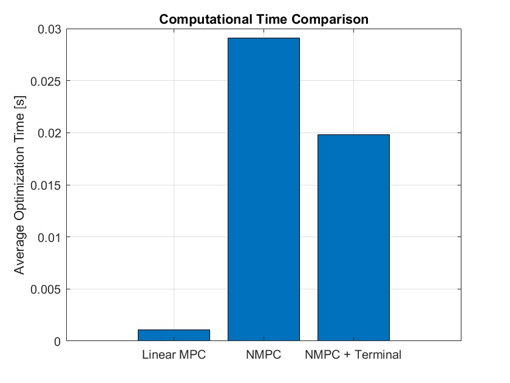
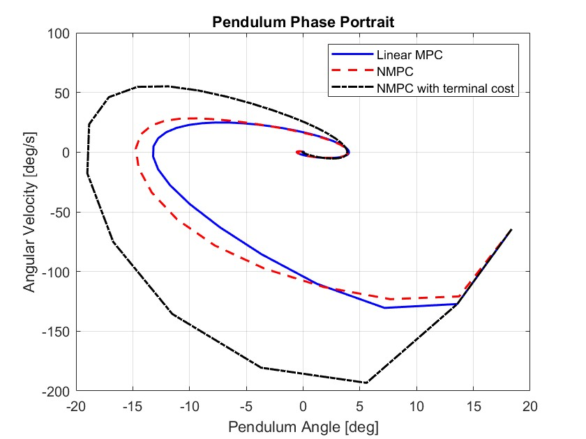
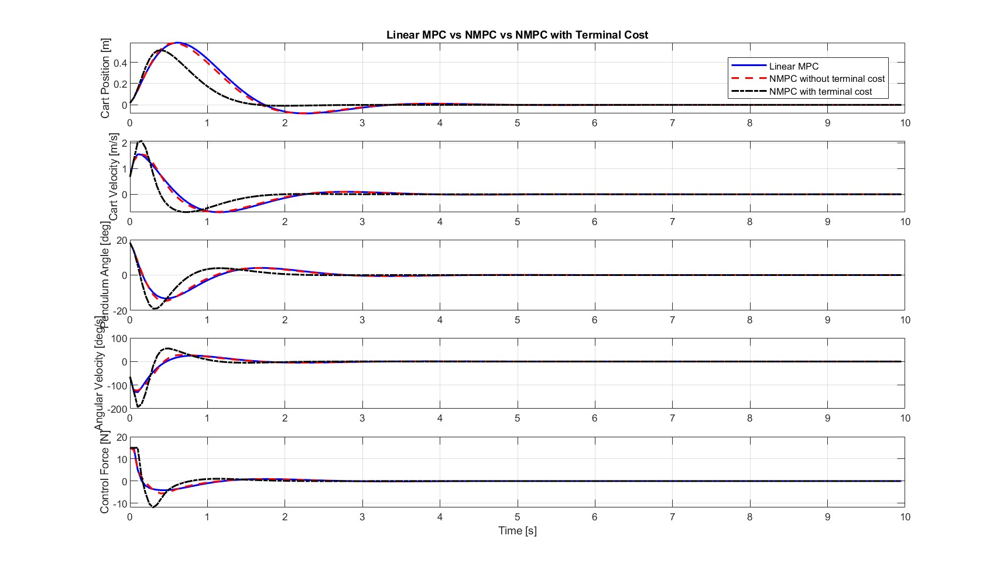

# Inverted Pendulum Control Using MPC and NMPC

## Overview

This repository contains MATLAB implementations of Model Predictive Control (MPC) and Nonlinear Model Predictive Control (NMPC) for an inverted pendulum system.

The project explores and compares three predictive control strategies for stabilizing an inverted pendulum:

1. Linear Model Predictive Control (Linear MPC)
2. Nonlinear Model Predictive Control (NMPC) without terminal cost
3. Nonlinear Model Predictive Control (NMPC) with LQR-based terminal cost

## System Description

The inverted pendulum system consists of a pendulum mounted on a horizontally moving cart. The control input is the horizontal force applied to the cart.

The system states are:

- Cart position (m)
- Cart velocity (m/s)
- Pendulum angle (rad)
- Pendulum angular velocity (rad/s)

The control objective is to stabilize the pendulum around its upright equilibrium while regulating cart position and respecting actuator constraints.

## Implemented Controllers

### 1. Linear MPC

Uses a linearized state-space model of the inverted pendulum for prediction and constrained optimization.

### 2. NMPC Without Terminal Cost

Uses the nonlinear system model for prediction, with numerical integration using the fourth-order Runge–Kutta (RK4) method.

### 3. NMPC With LQR-Based Terminal Cost

Extends the nonlinear MPC formulation by including an LQR-based terminal penalty to influence the predicted terminal state.

## MATLAB Files

| File | Description |
|---|---|
| `Linear_MPC_Comparison.m` | Linear MPC implementation |
| `NMPC_Without_Terminal_Cost.m` | Nonlinear MPC without terminal cost |
| `NMPC_With_Terminal_Cost.m` | Nonlinear MPC with LQR-based terminal cost |
| `Three_MPC_Comparison.m` | Comparative simulation of the three controllers |

## Software Requirements

- MATLAB
- Optimization Toolbox (`quadprog` and `fmincon`)
- Control System Toolbox (for state-space modeling and LQR calculations, where used)

## How to Run

1. Clone or download this repository.
2. Open MATLAB.
3. Add the downloaded project folder to the MATLAB path.
4. Open the desired `.m` file.
5. Run the script.

For the comparative study, run `Three_MPC_Comparison.m`.

## Performance Evaluation

The three controllers are evaluated using the following performance metrics:

- Pendulum angular response
- Cart position response
- Integral of Absolute Error (IAE)
- Control energy
- Maximum control force
- Computational time
- Settling time
- Quadratic control-effort index calculated as \(J_u=\sum_{k=0}^{N-1}u_k^2T_s\), where \(u_k\) is the applied control force and \(T_s\) is the sampling time. The resulting unit is N²·s.

### Performance Comparison

The numerical simulation results are provided in the following CSV file:

[**Download MPC Performance Comparison (CSV)**](Three_MPC_Performance_Comparison.csv)

### Simulation Results

**1. Computational Time**

**2. Phase Portrait**

**3. Trajectory Plots**

These results provide a visual and numerical basis for comparing the performance and computational requirements of Linear MPC, NMPC, and NMPC with Terminal Cost.

## Key Findings

The comparative MATLAB simulation demonstrates the trade-offs among Linear MPC, NMPC without terminal cost, and NMPC with LQR-based terminal cost.

The main observations are:

1. **Improved angular stabilization:** NMPC with terminal cost achieved the lowest angular Integral of Absolute Error (IAE), with a value of 0.2058.
2. **Better cart position regulation:** It achieved the lowest position IAE of 0.3870, representing approximately 41.9% improvement compared with Linear MPC.
3. **Faster stabilization:** Its settling time was 1.85 s, approximately 40.3% shorter than Linear MPC.
4. **Control energy trade-off:** Its control energy was 60.0261, higher than Linear MPC (32.5674) and NMPC without terminal cost (32.7952).
5. **Computational efficiency:** Linear MPC had the shortest mean optimization time (0.00111 s). NMPC with terminal cost required 0.01979 s, compared with 0.02908 s for NMPC without terminal cost.

All three controllers reached the maximum control force limit of 15 during the simulation.

Overall, NMPC with LQR-based terminal cost provided the best tracking accuracy and fastest stabilization in this simulation, at the expense of increased control energy and computational cost compared with Linear MPC.

## Project Status

**Ongoing development.**

The repository currently includes the MATLAB implementations, comparative simulation results, and performance figures. Further improvements, additional testing, and documentation may be added in future updates.

## Author

**Dawit Gizachew Misikir**

Electrical and Computer Engineering  
Control and Instrumentation Engineering

## License

No license has been assigned yet. All rights are reserved by the author unless a license is added to this repository.
